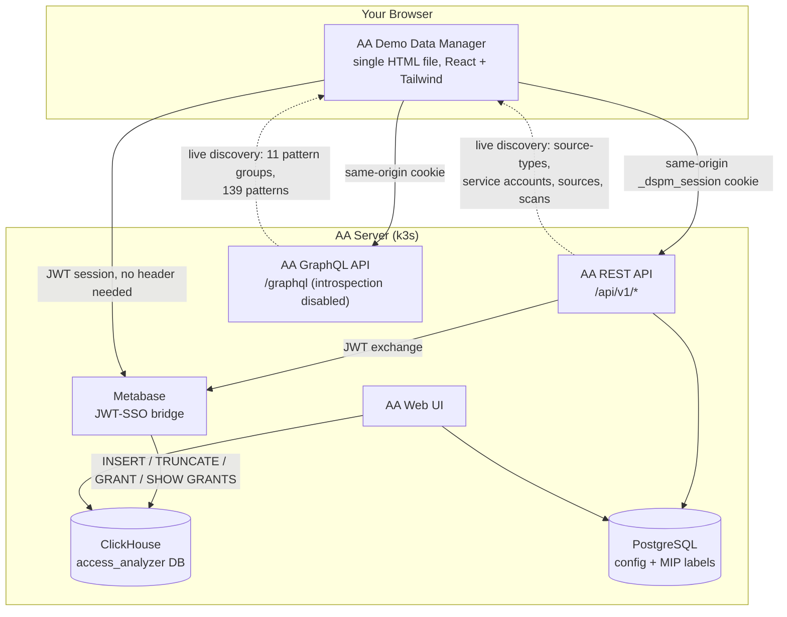
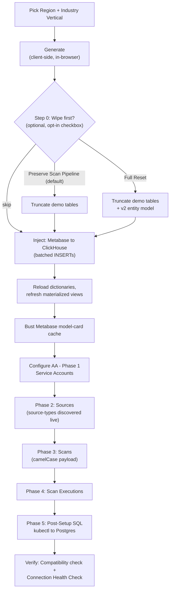

# Greater Good - AA Demo Data Manager

---

# AA Demo Data Manager

**Last updated:** 2026-09-18 **Current version:** 3.3.3 **File size:** ~483 KB / 6,519 lines **Deployed at:** https://appaa.cloud.lab/demo-manager/

---

## What Is This?

The Demo Data Manager is a browser-based tool that transforms a blank Netwrix Access Analyzer installation into a fully populated demo environment in under 5 minutes. It generates realistic corporate data, configures every page a prospect or evaluator would see during a demo or POC, and — new since v3.2.0 — can tell you when the connected AA instance has drifted from what it was built against, before that drift turns into a confusing failure mid-demo.

Single-file React HTML application (zero build dependencies — pure CDN React + Tailwind) that generates synthetic Netwrix Access Analyzer demo data and injects it directly into AA's ClickHouse database via the Metabase API. Also auto-configures AA sources/scans/service-accounts via the AA REST API, and — new — discovers the AA instance's real Sensitive Data Pattern catalog live via GraphQL rather than shipping a fictional one.

Designed for Solutions Engineers to spin up realistic, region-appropriate demo environments in 2–5 minutes without provisioning real AD, FS, SharePoint, or M365 infrastructure.

**Note on naming:** the app itself was renamed from "AA26 Demo Data Manager" to **"AA Demo Data Manager"** in v3.2.2 — the "26" was scrubbed from all user-facing branding (title, header, exports) since it refers to an internal codename rather than the product's own name. References to "AA" throughout the app and this doc mean the connected Netwrix Access Analyzer product; the tool's own name just dropped the suffix.

## What Problem Does It Solve?

A fresh AA install has empty dashboards, no users, no file permissions, no scan history. Setting up realistic demo data manually means connecting real Active Directory, file servers, and SharePoint — which requires infrastructure, credentials, and hours of scanning.

This tool bypasses all of that. It generates synthetic data that looks like a real Fortune 500 environment and injects it directly into AA's databases, populating every report and configuration page.

## Why This Matters for SE Pipeline

If you've ever demoed Access Analyzer to a customer in EMEA, LATAM, or APAC, you've felt it: the data looks American. James Smith from Austin, TX. ACME Corp. The customer's brain has to do a mental find-replace the whole call.

Region is the top-level cascade point for the entire demo dataset — pick it before Industry Vertical, same as v3.1.0. What's new: the name/office data driving that region is no longer fixed. **v3.2.5** added an "Edit Data" button that opens a slide-out drawer where you can add, edit, or remove first names, last names, and HQ offices per region directly — no code change needed to tweak the catalog for a specific customer story.

---

## Architecture at a Glance

## Phase Pipeline (Inject + Configure)

## What's New Since v3.1.0

This is the honest, substantial part — a lot changed. Grouped by theme rather than chronologically:

### Real data replacing fictional data (v3.2.0)

The single biggest architectural change. **Sensitive Data Patterns were completely reworked**: the old hardcoded 16-entry taxonomy list (PII, PHI, SOX, FERPA, NIST 800-171, PIPEDA, LGPD, Legal, etc., each with made-up term lists) is gone. In its place, the app **discovers the real Sensitive Data Pattern catalog live** from the connected AA instance via GraphQL (`/graphql` — a separate API surface from the REST `/api/v1/*` layer, introspection disabled, discovered by reading the Apollo Client cache). Confirmed against AA v1.1.5/v1.1.6: **11 real built-in Pattern Groups** (CCPA, CMMC, Credentials, Financial Records, GDPR, GDPR Restricted, GLBA, HIPAA, PCI DSS, PHI, PII) and **139 real Patterns**, each with an actual regex and confidence level.

Consequence: the Classification tab now shows AA's actual Pattern Groups as toggles with real pattern names as sample chips, not a separate list the tool invents. Any custom group/pattern added in AA itself shows up automatically next connect — no code change needed. The 8 vertical templates were remapped from fictional group names onto the real 11 (e.g., Federal went from `Classified/CUI/ITAR/FedRAMP` to `CMMC/GDPR Restricted/PII/Credentials`) — some industry-specific flavor was lost in that remap since AA doesn't ship FERPA/NERC CIP/ITAR/CUI as real patterns; a deliberate tradeoff, not an oversight.

**Locale no longer injects fictional regional regulations either.** The old `LOCALES` table's "Regs added" column (LGPD, Marco Civil, BDSG, TTDSG, RODO, LOPDGDD, etc.) is **removed** — none of those ever corresponded to a real AA pattern, so keeping that cascade would have reintroduced the same fictional/real mismatch this rework fixed. Vertical selection alone now drives which real pattern groups are enabled; region only drives names/offices/domain/phone format.

A real, previously-silent bug got fixed in the same pass: `cifs_sensitive_data` and `sharepoint_sensitive_data` were inserting into `taxonomy_name`/`term_name` columns that **don't exist** in the current schema — the real columns are `matches`/`pattern_matches` (Array-of-Tuple types). Confirmed live: both tables sat at 0 rows despite generation reporting success, for an unknown amount of time before this was caught.

### Editable catalogs, not just curated ones (v3.2.5–v3.2.7)

- **Region Data drawer** — first names, last names, and HQ offices per region are now add/edit/remove-able from a slide-out drawer (Region section → "✏️ Edit Data"), writing into `cfg.localeOverrides[locale]`. Falls back to the original curated pools when no override exists, so nothing changes unless you touch it.
- **Additional Domains** (multi-domain email/UPN, v3.2.6–v3.2.7) — an org can now have more than one accepted mail domain (e.g., `acme.local` + `acme.io` + `test.acme.com`). Wired into all 10 places emails/UPNs get generated (AD users, guests, SharePoint owners/authors/creators), weighted **60% primary domain / 40% spread across additional ones**. Validated on entry (format check, duplicate check, can't duplicate the primary domain) after an early version let anything through. **Important architectural note, confirmed by code inspection**: this only ever produces an `@suffix` string on generated emails — it has zero path into AD DN construction or SID base, both of which stay hardwired to the single primary `domainFqdn`/`sidBase`. Adding a domain here cannot create a second forest.

### AA version compatibility checking (v3.2.0, v3.3.1–v3.3.2)

Header now shows **"Supports AA v1.1.5, v1.1.6"** (a list, `AA26_SUPPORTED_VERSIONS`, not a single string — confirmed-compatible versions get added to the list rather than replacing the old one, so a real older-version connection never shows a false mismatch) next to the live-detected connected version. A mismatch shows an amber badge that's **clickable**, opening a Compatibility drawer that live-diffs the 13 tables the generator writes fixed column lists to against the connected instance's actual schema, flags any missing columns (the failure mode that actually breaks an INSERT), and offers a "copy report" button formatted to paste into a Claude session for the actual fix. It detects and describes drift; it doesn't rewrite its own generator code — that step still needs a human bringing the report back to a session like this one.

### New activity tables (v3.1.4)

`netwrix_activity_monitor_ad` and `netwrix_activity_monitor_entra` didn't exist in earlier AA versions — AD and Entra activity used to fall into a generic bucket. Both are now generated: AD logons/Kerberos TGT-TGS/object changes/lockouts/LDAP queries; Entra sign-ins/conditional access/risk detections/MFA challenges, using the same AD users so identities line up across both logs. Both are schema-driven (read live columns rather than a hardcoded list), so they should survive future schema drift better than the hand-written tables.

### UI reorganization (v3.2.4–v3.3.3)

- **Config Presets** moved from a Connection-tab card to a 💾 icon button in the header, left of the tab nav — click opens Export/Import as a small dropdown.
- **Run History** moved from a page section into a slide-out drawer, reachable via a 📜 History button (with live count) at the far right of the Jump-to bar on every tab, not just Generate.
- **Wipe Data (Step 0)** now has an explicit checkbox, unchecked by default, that grays out and collapses the section until deliberately enabled — a destructive action is no longer one accidental click away.
- **Generate page restructured**: new Step 1 ("Activity Timeline") holds Rich Activity Timeline, Activity Patterns by Time, a **History Depth preset selector** (3/6/9/12-month buttons, new in v3.2.6, alongside the existing free-form Organization-page input — both control the same setting), and the Timeline/scans + "how this affects speed & volume" cards, all moved off the Organization page. Everything below renumbered (old Step 1→2, Step 2→3, Step 3→4); also caught and fixed a pre-existing bug where Generated Data and Injection Log had both been labeled "Step 4" independently of this move.
- **Layout widened** to 80% of viewport width (`w-4/5`) instead of a fixed max-width container.
- **Scroll-to-top on step change** — Next/Back/Jump-to used to leave scroll position wherever the previous step had it.

### `normalized_permissions` — a real, systemic bug found and fixed (v3.3.0)

Every row in `cifs_permission`/`cifs_share_permission` was writing the literal placeholder string `'000000'` regardless of what permission was actually granted — a "GENERIC_ALL" (Full Control) row and a "GENERIC_READ" row got the identical, meaningless value. Found via Netwrix's own published FileSystem Permissions Format Reference: the real format is a positional 6-letter code, always in order **L-R-W-D-M-A** (List/Read/Write/Delete/Manage-DAC/take-Ownership), `-` where a right isn't granted — confirmed the column really is `FixedString(6)`. Fixed at all 8 generation sites with a real `normalizePerms()` mapper. **SharePoint's equivalent column is a separate, still-open item** — it's `FixedString(5)`, a different scheme SharePoint permission levels don't map onto the same way, and no documented letter definitions were found; left visibly using its own placeholder rather than guess at a scheme that might be equally wrong.

### Permissions — two separate grant fights, now one button (v3.2.4, v3.2.8–v3.2.9)

ClickHouse permission grants on a fresh AA install turned out to be **two distinct privilege sets**, discovered the hard way across separate live-testing sessions:

| Privilege set | Unlocks | Scope |
|---|---|---|
| `INSERT, TRUNCATE, ALTER DELETE, ALTER UPDATE` | Injection, wipe, selective removal, rehydration | `access_analyzer.*` |
| `SYSTEM RELOAD DICTIONARY, SYSTEM REFRESH VIEW` | Dictionaries/materialized views actually refreshing post-inject — without this, reports can show stale/empty data even though injection reported 0 errors | `*.*` |

The "⚡ Grant DB Permissions" button (Connection tab) now attempts both in one click, with a combined kubectl fallback command for when self-granting the `*.*`-scoped SYSTEM privileges is blocked (common, even when the narrower scope isn't). **Verification was rebuilt too**: originally checked whether *that click's* self-grant attempt succeeded, which meant it kept reporting failure even after the real privileges were confirmed granted via kubectl — because self-granting and having-the-privilege are different questions. Now uses `SHOW GRANTS` (resolves effective privileges including via role membership, and doesn't require elevated visibility into `system.grants` the way a direct query does) and distinguishes "the check itself failed" from "genuinely found nothing," rather than collapsing both into the same misleading message.

### Source-type UUIDs — a real production bug (v3.2.2)

`aa26ConfigPlan`'s source creation was sending source-type UUIDs hardcoded from the **original** lab. A different/fresh AA environment has entirely different UUIDs for the same source types — confirmed live: this AA version dropped plain `entra-id`/`sharepoint` in favor of `-ccf` variants and added a new `file-server-discover` type. Feeding a stale UUID crashed the backend with **HTTP 500** on every single source, cascading into every dependent scan failing too. Fixed: sources now discover real UUIDs live via `/api/v1/source-types` before creating anything. `localgroups` remains hidden from that discovery endpoint in every version seen so far — that one source cleanly skips with an honest message instead of crashing.

### Wipe completeness — "Preserve Scan Pipeline" clarified, not changed (v3.3.3)

Not a bug, but a real point of confusion worth documenting: the ClickHouse wipe has a **"Preserve scan pipeline" toggle, default ON**, that deliberately skips `entities`, `principals`, `permissions`, `permission_sets`, and related v2-model tables so Report pages keep working post-wipe. The catch: **Shared Links, High Risk ACLs, and Open Access read from exactly that preserved data**, not the raw scan tables — so the default wipe mode leaves those three reports showing old numbers, which looks like a broken wipe but is the toggle working as designed. Messaging updated in three places (toggle help text, description, confirm modal) to name the affected reports explicitly. Fix when you actually want them to clear: switch to "Full Reset," or just run a fresh Generate + Inject.

---

## v3.3.3 Catalog Reference

### LOCALES (9 entries) — `cfg.global.locale`

| Code | Name | Flag | TLD(s) | Legal | Phone |
|------|------|------|--------|-------|-------|
| `us` | United States | 🇺🇸 | `.com` | Inc/LLC/Corp | `+1` |
| `latam_pt` | LATAM (Brazil/PT) | 🇧🇷 | `.com.br` | Ltda/S.A./S.A.S./EIRELI | `+55` |
| `latam_es` | LATAM (Spanish) | 🇲🇽 | rotate `.mx`/`.ar`/`.co`/`.cl`/`.pe` | S.A./S.A. de C.V./S.R.L./S.A.C. | `+52` |
| `uk` | United Kingdom | 🇬🇧 | `.co.uk` | Plc/Ltd | `+44` |
| `de` | Germany | 🇩🇪 | `.de` | GmbH/AG/KG | `+49` |
| `it` | Italy | 🇮🇹 | `.it` | S.p.A./S.r.l. | `+39` |
| `fr` | France | 🇫🇷 | `.fr` | SA/SAS/SARL | `+33` |
| `slavic` | Slavic (RU/PL/CZ) | 🇵🇱 | rotate `.ru`/`.pl`/`.cz` | OOO/Sp. z o.o./s.r.o. | `+48` |
| `es` | Spain | 🇪🇸 | `.es` | S.A./S.L. | `+34` |

*The "Regs added" column from the v3.1.0 doc is removed — see "Real data replacing fictional data" above for why. First/last names and HQ offices per locale are now editable (Region → Edit Data) rather than fixed; the pools listed in the original doc are the defaults, not a ceiling.*

### VERTICAL_TEMPLATES (9 entries) — `cfg.global.vertical`, with real pattern groups (post v3.2.0 remap)

| Vertical | Icon | US AD domain | Enabled Pattern Groups (real, v3.2.0+) |
|----------|------|--------------|------------------------------------------|
| `generic` | 🏢 | ACME | PII, PHI, PCI DSS, Financial Records, Credentials, GDPR, GDPR Restricted, CCPA, HIPAA, CMMC, GLBA (all 11) |
| `healthcare` | 🏥 | MERIDIANHEALTH | PHI, PII, HIPAA, PCI DSS |
| `finance` | 💰 | SUMMITFINANCIAL | PCI DSS, PII, Financial Records, GDPR, GLBA |
| `manufacturing` | 🏭 | TITANINDUSTRIES | CMMC, Credentials, PII, Financial Records |
| `engineering` | 💻 | NEXUSCLOUD | Credentials, PII, PCI DSS, GDPR |
| `federal` | 🏛 | METROCOUNTY | CMMC, PII, GDPR Restricted, Credentials |
| `education` | 🎓 | GREATPLAINS | PII, PCI DSS, GDPR, Credentials |
| `retail` | 🛍 | TRENDMART | PCI DSS, PII, GDPR, Financial Records |
| `energy` | ⚡ | PACIFICPOWER | CMMC, PII, Credentials, GDPR Restricted |

*Departments, themed FQDNs, and company-name matrix are unchanged from v3.1.0.*

### Sensitive Data Patterns (replaces the old fictional taxonomy table)

Discovered live from the connected instance, not maintained by this tool. Confirmed against AA v1.1.5/v1.1.6:

- **11 groups**: CCPA, CMMC, Credentials, Financial Records, GDPR, GDPR Restricted, GLBA, HIPAA, PCI DSS, PHI, PII
- **139 patterns**, each with a real regex and confidence level (high/medium/low), many-to-many mapped to groups
- Custom groups/patterns added directly in AA (Configuration → Sensitive data patterns) show up automatically on next connect

---

## Critical Gotchas — Never Lose These

### Authentication

- Cookie name is `_dspm_session`, NOT `_session_id` (docs lied — still true)
- Browser blocks cross-origin Cookie header (Fetch spec) — same-origin hosting or Chrome MCP only
- **Metabase auth changed**: direct username/password login (`POST /metabase/api/session`) now returns a flat **403 at the gateway**, not a Metabase auth error. Current flow: exchange the caller's own AA session for Metabase access via JWT SSO — `GET /api/v1/auth/metabase/sso?response=json` (uses the existing `_dspm_session` cookie) → returns `{jwt}` → `GET /metabase/auth/sso?jwt=...` establishes the Metabase session cookie. All Metabase calls after that use `credentials:'include'`, no session header.

### AA REST API

- Service Account POST: `client_id` & `tenant_id` at ROOT level, NOT in parameters array — still true, but the `client_id_certificate` shape **changed**: `tenant_id` moved from root into `values`; `parameters` now carries only `client_certificate` (no `private_key` sent at all) — AA self-generates the RSA key pair server-side ("Generate for me").
- Three SA shapes: `username_password` (root+parameters/values), `client_id_secret` (root client_id + parameters client_secret), `client_id_certificate` (see above)
- Sources: `{name, sourceTypeId, connectionParameters}` — simple shape, unchanged. **But `sourceTypeId` values are environment-specific and must be discovered live** via `/api/v1/source-types` — never hardcode them (see "Source-type UUIDs" above; this caused real HTTP 500s in production use).
- Scans: **payload shape changed to camelCase** — `{name, scanType, target:{mode:"sources", sourceIds:[...]}, cronEnabled:false}`. `scan_type`→`scanType`, `source_id`→`target.mode/sourceIds` (now an array — a real targeting-model change, not just a naming one), `cron_enabled`→`cronEnabled`. Always `cronEnabled:false` — `true` would trigger real scans against fake hosts.
- Scan executions: state machine `pending → running → completed` — cannot skip states. Field naming inferred as camelCase (`scanId`) by analogy with the confirmed Scans rewrite; not independently live-verified.
- The hidden `localgroups` source type is still NOT in the `/source-types` response in any version checked so far — sources of this type can't be created via the API; the orchestrator now skips it cleanly instead of sending a guessed UUID that would 500.

### Sensitive Data Patterns API

- Lives on a **separate GraphQL endpoint** (`/graphql`), not the REST `/api/v1/*` surface — same-origin `_dspm_session` cookie auth
- **Introspection is disabled** server-side; the schema was discovered by reading `window.__APOLLO_CLIENT__.cache.extract()` in the browser, which reveals real query names (`sensitiveDataPatternGroups(page,pageSize)`, `sensitiveDataPatterns(page,pageSize)`) and object shapes
- Server caps pagination at 100 results per page regardless of requested `pageSize` — paginate for the full set

### ClickHouse / Metabase

- INSERT via `POST /metabase/api/dataset` returns `status: 'failed'` with "Select statement did not produce a ResultSet" even on success — cosmetic, must ignore. Still true.
- `_latest`-suffix tables and other MaterializedViews have independent inner storage — clear via `ALTER TABLE ... DELETE WHERE 1=1`, NOT TRUNCATE. Still true.
- **ClickHouse DB id is NOT stable across environments** — the old assumption of `database:2` was a real, silent bug on a fresh lab: DB #1 turned out to be the real "Access Analyzer Data Warehouse (ClickHouse)," DB #2 a decoy named `access_analyzer_sample`. Fixed: the app now queries `/metabase/api/database` on connect and picks the non-sample ClickHouse entry automatically, storing it as `cfg.connection.databaseId`.
- **Permission grants are two separate scopes, not one** — see "Permissions" above. Verify actual current grants with `SHOW GRANTS`, not a direct `system.grants` query (visibility-restricted for non-admins in some setups, and misses role-based grants — a query failure there is easy to mistake for "zero privileges").
- **`SYSTEM RELOAD DICTIONARY` is genuinely a separate privilege**, not something that "just reloads automatically" — several dictionaries do lazy-load via SELECT fallback without it, but not all (confirmed 2–3 of 7 stayed empty on lazy-load alone in live testing). Grant it explicitly.
- `sharepoint_online_objects.item_type` accepts only: `SITE`, `LIST`, `LIBRARY`, `LIST_ITEM`. Still true.
- `normalized_permissions`: **CIFS** (`cifs_permission`, `cifs_share_permission`) is `FixedString(6)`, real scheme confirmed as positional `L-R-W-D-M-A` letters, `-` for absent (Netwrix's own FileSystem Permissions Format Reference). **SharePoint** (`sharepoint_online_permissions`) is `FixedString(5)`, a different, still-undocumented scheme — don't assume it's the same letters.
- Non-nullable LowCardinality columns reject NULL (use `''` instead). Still true.
- SPO reports join on `(web_id, drive_item_id)`, NOT `absolute_url`. Still true.

### MIP Labels (PostgreSQL) — unchanged since v3.1.0

- `mip_labels` table has `label_id` as `varchar` (label name string like "public"), not UUID — sending UUID makes mappings show as "(removed)"
- `last_synced_at` IS NULL filter — API hides rows without timestamp; must set `NOW()` on insert
- `sensitive_data_config` is ONE GLOBAL row; `mip_entra_source_id` points to one tenant at a time
- FK CASCADE: deleting Entra source auto-deletes its mip_labels

### Data Modeling — unchanged since v3.1.0

- ReplacingMergeTree dedup collapses SHARE and root DIRECTORY entries sharing the same path key — must use distinct path keys
- AD risk catalog requires exact `risk_category` values matching card filters (`'User'`, `'Group'`) — not human labels

### Operational

- **Wipe ≠ wipe everything by default.** "Preserve Scan Pipeline" (default ON) intentionally skips `entities`/`principals`/`permissions`/`permission_sets`/etc. — Shared Links, High Risk ACLs, and Open Access will keep showing old data until "Full Reset" or a fresh inject. Not a bug; a default that surprised at least one person in production use, so documenting it here too.
- **Metabase model-card cache-bust**: 2 of 14 hardcoded card IDs require a dashboard filter parameter and will 400 on the generic parameterless refresh call — expected, cosmetic, those two need a manual dashboard-side refresh.
- **kubectl access on a fresh server** frequently needs a personal kubeconfig copy rather than relying on group membership: `sudo cp /etc/rancher/k3s/k3s.yaml ~/.kube/config && sudo chown $(id -u):$(id -u) ~/.kube/config && chmod 600 ~/.kube/config && export KUBECONFIG=~/.kube/config`. See the New Server Install Guide for the full sequence.

---

## State Persistence

`cfg` lives in React state, auto-saves to localStorage. Key structure as of v3.3.3:

- `cfg.global.locale` — current region
- `cfg.global.additionalDomains` — additional accepted email/UPN domains (v3.2.6+)
- `cfg.localeOverrides[locale]` — user-edited name/office pools overriding the built-in catalog for that region (v3.2.5+)
- `cfg.sd.enabledGroups` — which real (discovered) Sensitive Data Pattern groups to emphasize; replaces the old `cfg.sd.taxonomies` fictional list entirely (v3.2.0)
- `cfg._sdCatalog` — the live-discovered Sensitive Data Pattern catalog (groups + patterns), populated on Detect Session
- `cfg.connection.aa26LiveVersion` — the connected instance's real detected AA version, compared against `AA26_SUPPORTED_VERSIONS`
- `cfg.connection.databaseId` — auto-discovered non-sample ClickHouse database id (no longer hardcoded)
- `cfg.history.injectedAA26.{serviceAccountIds, sourceIds, scanIds}` — UUID tracking for ID-precise wipe (v3.1.0, unchanged)

## Approach & Patterns

- **Investigate before coding**: Chrome MCP-driven live API discovery before writing implementation — reinforced hard this cycle. Every "we assumed X" (source-type UUIDs, ClickHouse DB id, normalized_permissions format, SHOW GRANTS vs system.grants) turned out wrong in a way live checking caught and hardcoding would have hidden.
- **Surgical edits**: `str_replace` or targeted Python — never full-file rewrites.
- **Validation gate**: `@babel/parser` parses JSX before HTML rebuild — catches missing braces, unescaped chars, unbalanced tags. Non-negotiable before every rebuild.
- **Iterative validation**: fix → wipe DB → inject → verify in browser → next issue.
- **Detection over silent assumption**: the new Compatibility drawer is this principle turned into a feature — surface drift explicitly rather than let it fail quietly downstream.
- **Sessions end with**: updated Status/Handoff/QuickStart + release notes + this doc (when the change is user-facing).

## Tools / Environment

- Chrome MCP — primary live API discovery; device/tab IDs rotate per session
- kubectl + SCP via SSH — deploy (see New Server Install Guide for the fresh-kubeconfig gotcha)
- Metabase API — ClickHouse INSERTs (`POST /metabase/api/dataset`); auth via JWT-SSO exchange (see Authentication above), not direct session login
- AA REST (`/api/v1/`) — sources, scans, service accounts, scan-executions; source-type UUIDs discovered live, never hardcoded
- AA GraphQL (`/graphql`) — Sensitive Data Pattern Groups/Patterns, introspection disabled
- Lab: `appaa.cloud.lab`, effective identity via JWT-SSO: `cloudlab@netwrix.com`; ClickHouse service account `access_analyzer_metabase`; ClickHouse database id auto-discovered (was incorrectly assumed fixed at `2` — see gotchas)

## Support

For questions, feedback, or feature requests, see the project portal or reach out to the Solutions Engineering team, Eric Garlepp.
