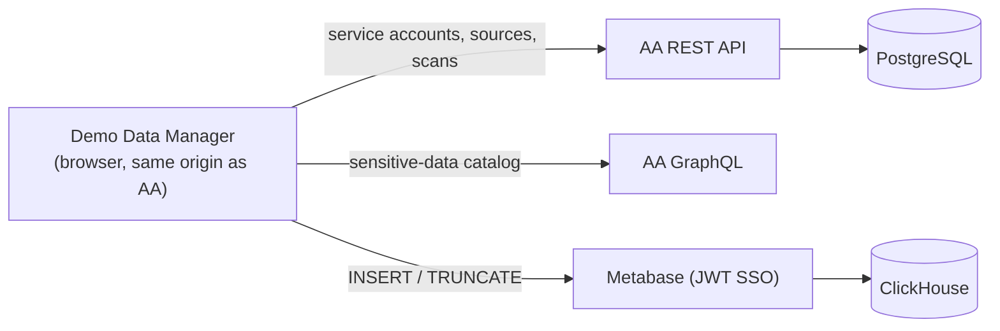

# AA Demo Data Manager

**A Greater Good project — unofficial, community-maintained, not a Netwrix product.**

A single-file browser app that turns a blank [Netwrix Access Analyzer](https://www.netwrix.com/) (AA) lab install into a fully populated demo environment in a few minutes. It generates realistic, region-appropriate synthetic corporate data — Active Directory, Entra ID, file servers, SharePoint Online, activity, sensitive-data matches — injects it into AA's database, and configures AA's service accounts, sources and scans so every page a prospect or evaluator sees has data.

> [!WARNING]
> **For disposable lab instances only.** This tool writes directly into AA's ClickHouse and PostgreSQL databases, can TRUNCATE tables and delete AA configuration, and asks you to grant the Metabase database user broad write privileges. Never point it at a production or customer AA instance. See [SECURITY.md](SECURITY.md).

> [!NOTE]
> This is not an official Netwrix product, is not supported by Netwrix Support, and is not covered by any Netwrix warranty or SLA. "Netwrix" and "Access Analyzer" are trademarks of Netwrix Corporation and are used here only to describe what this tool works with.

---

## Why

A fresh AA install has empty dashboards, no users, no permissions and no scan history. Populating it for real means standing up AD, file servers and SharePoint, wiring credentials, and waiting hours for scans. This tool skips all of that.

It is also built for demos outside the US: pick a **region** (US, UK, Germany, France, Italy, Spain, LATAM Portuguese/Spanish, Slavic) and names, offices, domains and phone formats follow; pick an **industry vertical** (healthcare, finance, manufacturing, federal, education, retail, energy, …) and departments, shares, SharePoint sites and enabled sensitive-data pattern groups follow.

## Features

- **9 regions × 9 industry verticals**, with editable name/office pools and multiple email/UPN domains
- **Scale presets** from small business (~50 users) to enterprise (~5,000 users) and configurable history depth (3–12 months)
- **Realistic activity** — file, SharePoint, AD and Entra sign-in activity with working-hours patterns and burst weeks
- **Live discovery** of the connected instance's Sensitive Data Pattern catalog, source-type IDs and ClickHouse database — nothing environment-specific is hardcoded
- **AA configuration** — creates service accounts, sources, scans and scan history through the AA REST API
- **Compatibility check** — diffs the generator's expected table schemas against the connected AA version and produces a drift report
- **Safe(ish) wipe** — opt-in, with demo-only (ID-tracked) and full-reset modes
- **Zero build** — one HTML file, React + Tailwind from CDNs, deployable as a ConfigMap

## Requirements

| | |
|---|---|
| **AA version** | v1.1.5, v1.1.6, v1.1.7 (the header shows the supported list and flags mismatches) |
| **Server access** | SSH with sudo to the AA server (k3s + Traefik), for the one-time install and DB grants |
| **Browser** | A current desktop browser (developed and tested on Chrome), logged in to AA |
| **Network** | The browser must reach `cdnjs.cloudflare.com`, `cdn.tailwindcss.com` and `fonts.googleapis.com` |

## Quick start

1. Copy the three deployment files to the AA server and run the installer:

   ```bash
   scp demo-data-manager.html demo-manager.yaml install-demo-manager.sh <user>@<aa-host>:~/demo-data-manager/
   ```

   ```bash
   ssh <user>@<aa-host> "cd ~/demo-data-manager && chmod +x install-demo-manager.sh && ./install-demo-manager.sh"
   ```

2. Log in to AA, then open `https://<aa-host>/demo-manager/`. On the **Connection** tab click **Connect**, **⚡ Grant DB Permissions**, and **Detect Session**.
3. Pick a region, vertical and demo profile, then on **Generate** click **Generate Demo Data** and **Configure AA**.

The full walkthrough — including the kubeconfig fix most fresh servers need and the manual GRANT fallback — is in **[docs/INSTALL.md](docs/INSTALL.md)**.

**Why same-origin?** AA authenticates with a session cookie. Browsers won't send it to a different origin, so the app is deployed under the AA host at `/demo-manager/`. Opened any other way (e.g. from `file://`), it runs in a limited ClickHouse-only mode.

## How it works



Data is generated entirely client-side, injected into ClickHouse through Metabase's SQL API, then AA's configuration is created through its REST API. One step — backdating scan history in PostgreSQL — can't be done over the API, so the app generates a small shell script to run on the server.

Details, API behaviour and data-model notes: **[docs/ARCHITECTURE.md](docs/ARCHITECTURE.md)**.

## Repository layout

| Path | Purpose |
|---|---|
| `demo-data-manager.html` | The app — source and deployable artifact in one file |
| `demo-manager.yaml` | k3s manifest: nginx Deployment, Service, Traefik Middleware + IngressRoute |
| `install-demo-manager.sh` | Installer/updater: `install`, `update`, `status`, `uninstall` |
| `docs/INSTALL.md` | Step-by-step install and troubleshooting |
| `docs/ARCHITECTURE.md` | Architecture, AA integration notes, catalog reference |
| `docs/CHANGELOG.md` | Release history |
| `docs/ROADMAP.md` | Deferred features and known limitations |

## Contributing

Issues and pull requests are welcome — see [CONTRIBUTING.md](CONTRIBUTING.md). Please don't include real customer data, credentials or hostnames in issues, logs or screenshots.

## License

[MIT](LICENSE). Provided as-is, without warranty of any kind.
