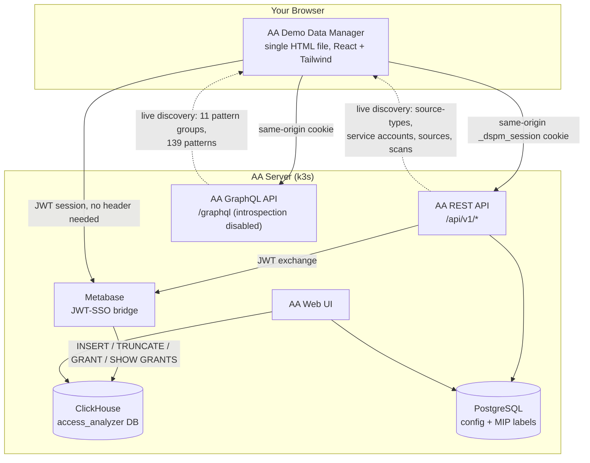
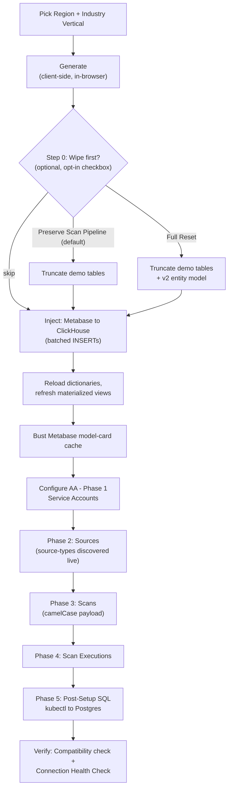

# Architecture & Technical Reference

How the AA Demo Data Manager talks to Netwrix Access Analyzer, what it writes, and the API behaviour it relies on. For setup, see [INSTALL.md](INSTALL.md).

## Architecture at a Glance

## Phase Pipeline (Inject + Configure)

## State Persistence

`cfg` lives in React state, auto-saves to localStorage. Key structure:

- `cfg.global.locale` — current region
- `cfg.global.additionalDomains` — additional accepted email/UPN domains (v3.2.6+)
- `cfg.localeOverrides[locale]` — user-edited name/office pools overriding the built-in catalog for that region (v3.2.5+)
- `cfg.sd.enabledGroups` — which real (discovered) Sensitive Data Pattern groups to emphasize; replaces the old `cfg.sd.taxonomies` fictional list entirely (v3.2.0)
- `cfg._sdCatalog` — the live-discovered Sensitive Data Pattern catalog (groups + patterns), populated on Detect Session
- `cfg.connection.aa26LiveVersion` — the connected instance's real detected AA version, compared against `AA_SUPPORTED_VERSIONS`
- `cfg.connection.databaseId` — auto-discovered non-sample ClickHouse database id (no longer hardcoded)
- `cfg.history.injectedAA26.{serviceAccountIds, sourceIds, scanIds}` — UUID tracking for ID-precise wipe (v3.1.0+)

Some persisted keys still carry an `aa26` prefix (`localStorage` keys `aa26_theme`, `aa26_connection`, `aa26_run_history`; `cfg.connection.aa26Host`, `aa26LiveVersion`, `aa26SessionCookie`; `cfg.history.injectedAA26`). They are kept as-is so saved state and exported presets from earlier versions keep loading.

## Catalog Reference

### LOCALES (9 entries) — `cfg.global.locale`

| Code | Name | Flag | TLD(s) | Legal | Phone |
|------|------|------|--------|-------|-------|
| `us` | United States | 🇺🇸 | `.com` | Inc/LLC/Corp | `+1` |
| `latam_pt` | LATAM (Brazil/PT) | 🇧🇷 | `.com.br` | Ltda/S.A./S.A.S./EIRELI | `+55` |
| `latam_es` | LATAM (Spanish) | 🇲🇽 | rotate `.mx`/`.ar`/`.co`/`.cl`/`.pe` | S.A./S.A. de C.V./S.R.L./S.A.C. | `+52` |
| `uk` | United Kingdom | 🇬🇧 | `.co.uk` | Plc/Ltd | `+44` |
| `de` | Germany | 🇩🇪 | `.de` | GmbH/AG/KG | `+49` |
| `it` | Italy | 🇮🇹 | `.it` | S.p.A./S.r.l. | `+39` |
| `fr` | France | 🇫🇷 | `.fr` | SA/SAS/SARL | `+33` |
| `slavic` | Slavic (RU/PL/CZ) | 🇵🇱 | rotate `.ru`/`.pl`/`.cz` | OOO/Sp. z o.o./s.r.o. | `+48` |
| `es` | Spain | 🇪🇸 | `.es` | S.A./S.L. | `+34` |

*First/last names and HQ offices per region are editable in the app (Region → ✏️ Edit Data); the built-in pools are defaults, not a ceiling. Region drives names, offices, domains and phone formats only — it does not enable any sensitive-data patterns.*

### VERTICAL_TEMPLATES (9 entries) — `cfg.global.vertical`

| Vertical | Icon | US AD domain | Enabled Pattern Groups |
|----------|------|--------------|------------------------------------------|
| `generic` | 🏢 | ACME | PII, PHI, PCI DSS, Financial Records, Credentials, GDPR, GDPR Restricted, CCPA, HIPAA, CMMC, GLBA (all 11) |
| `healthcare` | 🏥 | MERIDIANHEALTH | PHI, PII, HIPAA, PCI DSS |
| `finance` | 💰 | SUMMITFINANCIAL | PCI DSS, PII, Financial Records, GDPR, GLBA |
| `manufacturing` | 🏭 | TITANINDUSTRIES | CMMC, Credentials, PII, Financial Records |
| `engineering` | 💻 | NEXUSCLOUD | Credentials, PII, PCI DSS, GDPR |
| `federal` | 🏛 | METROCOUNTY | CMMC, PII, GDPR Restricted, Credentials |
| `education` | 🎓 | GREATPLAINS | PII, PCI DSS, GDPR, Credentials |
| `retail` | 🛍 | TRENDMART | PCI DSS, PII, GDPR, Financial Records |
| `energy` | ⚡ | PACIFICPOWER | CMMC, PII, Credentials, GDPR Restricted |

### Sensitive Data Patterns

Discovered live from the connected instance, not maintained by this tool. Confirmed against AA v1.1.5/v1.1.6:

- **11 groups**: CCPA, CMMC, Credentials, Financial Records, GDPR, GDPR Restricted, GLBA, HIPAA, PCI DSS, PHI, PII
- **139 patterns**, each with a real regex and confidence level (high/medium/low), many-to-many mapped to groups
- Custom groups/patterns added directly in AA (Configuration → Sensitive data patterns) show up automatically on next connect

---

## AA Integration Notes

Behaviour of the AA APIs and data model that the tool depends on, verified against AA v1.1.5–v1.1.7. Several of these differ from what you might assume — read before changing the integration code.

### Authentication

- Cookie name is `_dspm_session`, NOT `_session_id`
- Browser blocks cross-origin Cookie header (Fetch spec) — the app must be served from the AA origin for REST/GraphQL calls to authenticate
- **Metabase auth changed**: direct username/password login (`POST /metabase/api/session`) now returns a flat **403 at the gateway**, not a Metabase auth error. Current flow: exchange the caller's own AA session for Metabase access via JWT SSO — `GET /api/v1/auth/metabase/sso?response=json` (uses the existing `_dspm_session` cookie) → returns `{jwt}` → `GET /metabase/auth/sso?jwt=...` establishes the Metabase session cookie. All Metabase calls after that use `credentials:'include'`, no session header.

### AA REST API

- Service Account POST: `client_id` & `tenant_id` at ROOT level, NOT in parameters array; note that the `client_id_certificate` shape **changed**: `tenant_id` moved from root into `values`; `parameters` now carries only `client_certificate` (no `private_key` sent at all) — AA self-generates the RSA key pair server-side ("Generate for me").
- Three SA shapes: `username_password` (root+parameters/values), `client_id_secret` (root client_id + parameters client_secret), `client_id_certificate` (see above)
- Sources: `{name, sourceTypeId, connectionParameters}` — simple shape, unchanged. **But `sourceTypeId` values are environment-specific and must be discovered live** via `/api/v1/source-types` — never hardcode them (stale UUIDs cause HTTP 500 on source creation).
- Scans: **payload shape changed to camelCase** — `{name, scanType, target:{mode:"sources", sourceIds:[...]}, cronEnabled:false}`. `scan_type`→`scanType`, `source_id`→`target.mode/sourceIds` (now an array — a real targeting-model change, not just a naming one), `cron_enabled`→`cronEnabled`. Always `cronEnabled:false` — `true` would trigger real scans against fake hosts.
- Scan executions: state machine `pending → running → completed` — cannot skip states. Field naming inferred as camelCase (`scanId`) by analogy with the confirmed Scans rewrite; not independently live-verified.
- The hidden `localgroups` source type is still NOT in the `/source-types` response in any version checked so far — sources of this type can't be created via the API; the orchestrator now skips it cleanly instead of sending a guessed UUID that would 500.

### Sensitive Data Patterns API

- Lives on a **separate GraphQL endpoint** (`/graphql`), not the REST `/api/v1/*` surface — same-origin `_dspm_session` cookie auth
- **Introspection is disabled** server-side; the schema was discovered by reading `window.__APOLLO_CLIENT__.cache.extract()` in the browser, which reveals real query names (`sensitiveDataPatternGroups(page,pageSize)`, `sensitiveDataPatterns(page,pageSize)`) and object shapes
- Server caps pagination at 100 results per page regardless of requested `pageSize` — paginate for the full set

### ClickHouse / Metabase

- INSERT via `POST /metabase/api/dataset` returns `status: 'failed'` with "Select statement did not produce a ResultSet" even on success — cosmetic, must ignore.
- `_latest`-suffix tables and other MaterializedViews have independent inner storage — clear via `ALTER TABLE ... DELETE WHERE 1=1`, NOT TRUNCATE.
- **ClickHouse DB id is NOT stable across environments** — on some installs the real "Access Analyzer Data Warehouse (ClickHouse)" is DB #1 and DB #2 is a sample database named `access_analyzer_sample`. The app queries `/metabase/api/database` on connect and picks the non-sample ClickHouse entry automatically, storing it as `cfg.connection.databaseId`.
- **Permission grants are two separate scopes, not one**. Verify actual current grants with `SHOW GRANTS`, not a direct `system.grants` query (visibility-restricted for non-admins in some setups, and misses role-based grants — a query failure there is easy to mistake for "zero privileges").
- **`SYSTEM RELOAD DICTIONARY` is genuinely a separate privilege**, not something that "just reloads automatically" — several dictionaries do lazy-load via SELECT fallback without it, but not all (confirmed 2–3 of 7 stayed empty on lazy-load alone in live testing). Grant it explicitly.
- `sharepoint_online_objects.item_type` accepts only: `SITE`, `LIST`, `LIBRARY`, `LIST_ITEM`.
- `normalized_permissions`: **CIFS** (`cifs_permission`, `cifs_share_permission`) is `FixedString(6)`, real scheme confirmed as positional `L-R-W-D-M-A` letters, `-` for absent (Netwrix's own FileSystem Permissions Format Reference). **SharePoint** (`sharepoint_online_permissions`) is `FixedString(5)`, a different, still-undocumented scheme — don't assume it's the same letters.
- Non-nullable LowCardinality columns reject NULL (use `''` instead).
- SPO reports join on `(web_id, drive_item_id)`, NOT `absolute_url`.

### MIP Labels (PostgreSQL)

- `mip_labels` table has `label_id` as `varchar` (label name string like "public"), not UUID — sending UUID makes mappings show as "(removed)"
- `last_synced_at` IS NULL filter — API hides rows without timestamp; must set `NOW()` on insert
- `sensitive_data_config` is ONE GLOBAL row; `mip_entra_source_id` points to one tenant at a time
- FK CASCADE: deleting Entra source auto-deletes its mip_labels

### Data Modeling

- ReplacingMergeTree dedup collapses SHARE and root DIRECTORY entries sharing the same path key — must use distinct path keys
- AD risk catalog requires exact `risk_category` values matching card filters (`'User'`, `'Group'`) — not human labels

### Operational

- **Wipe ≠ wipe everything by default.** "Preserve Scan Pipeline" (default ON) intentionally skips `entities`/`principals`/`permissions`/`permission_sets`/etc. — Shared Links, High Risk ACLs, and Open Access will keep showing old data until "Full Reset" or a fresh inject. Not a bug.
- **Metabase model-card cache-bust**: 2 of 14 hardcoded card IDs require a dashboard filter parameter and will 400 on the generic parameterless refresh call — expected, cosmetic, those two need a manual dashboard-side refresh.
- **kubectl access on a fresh server** frequently needs a personal kubeconfig copy rather than relying on group membership: `sudo cp /etc/rancher/k3s/k3s.yaml ~/.kube/config && sudo chown $(id -u):$(id -u) ~/.kube/config && chmod 600 ~/.kube/config && export KUBECONFIG=~/.kube/config`. See [INSTALL.md](INSTALL.md) for the full sequence.

---
